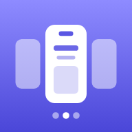
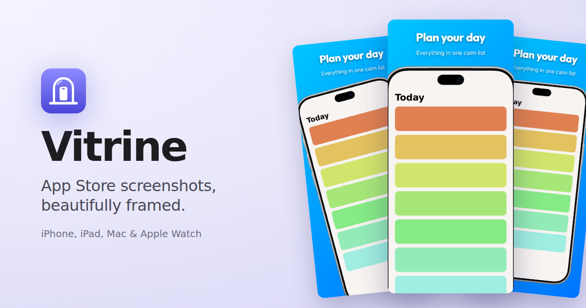

<p align="center">
  
</p>

<h1 align="center">Storyframe</h1>

<p align="center"><b>Your app's story, frame by frame.</b></p>

<p align="center"><b>🔗 <a href="https://screenshots.linkandreas.de/">Open Storyframe</a></b></p>

[](package.json)
[](https://opensource.org/licenses/MIT)
[](https://react.dev/)
[](https://vitejs.dev/)

App Store screenshots tell your app's story, one frame at a time. Storyframe turns your app's raw
screenshots into that story: pick a layout, a background and an Apple device frame, write the
headlines, and export pixel-perfect screenshots for every device and language. Free in the browser,
or from AI agents over MCP.



*Coded using Google Antigravity.*

## 🚀 Features

- **⚡ Bulk Export**: Generate high-resolution assets for multiple devices (iPhone & iPad) and all localizations in a single click.
- **📱 Every App Store Slot**: iPhone 6.9", iPhone Duo (open and closed), iPad 13", Mac and Apple Watch (Ultra and Series), with Apple's latest frames: iPhone 18 Pro Max, iPhone Duo, iPad Pro M5, MacBook Pro and MacBook Air M5, Apple Watch Ultra 3 and Series 11 (plus iPhone 17 Pro Max and iPad Pro M4).
- **🌍 Global Ready**: Comprehensive localization support with flag icons and automated text replacement.
- **🎨 Backgrounds**: 52 gradients for App Store screenshots in Vibrant, Warm, Cool, Soft and Dark, 28 solid colors, or your own, with text that stays readable automatically.
- **✋ Simple Controls**: Text, Background and Device tabs in plain language; drag the device on the canvas; apply one screen's style to all screens.
- **📐 Layouts**: Classic, Big & Bold, Floating, Text Below and Tilted presets as live previews, with full manual control (snap to centre, arrow-key nudging).
- **🆕 What's New**: Release notes in the app, generated from [CHANGELOG.md](CHANGELOG.md).
- **🔤 Brand Typefaces**: Eight self-hosted typefaces (sans and serif) for headlines and descriptions.
- **🌓 Light & Dark Mode**: A clean, native-feeling editor that leaves the color to your screenshots.
- **🤖 MCP Server**: Let Claude, Cursor or any MCP client render branded screenshot sets for you ([below](#-mcp-server-for-ai-agents)).
- **⚙️ Precise Control**: Fine-tune scale, rotation, and offsets with a live, 60fps preview.

## 🛠 Tech Stack

- **Core**: React 19 + TypeScript
- **Build Tool**: Vite 6
- **Styling**: Vanilla CSS (High Performance)
- **Engine**: `html-to-image` for high-resolution canvas capture
- **Compression**: `JSZip` for automated bulk downloads

## 📦 Getting Started

### Prerequisites

- [Node.js](https://nodejs.org/) (v18 or higher)
- [npm](https://www.npmjs.com/) or [pnpm](https://pnpm.io/)

### Installation

1. Clone the repository:
   ```bash
   git clone https://github.com/your-username/app-store-screenshot-generator.git
   cd app-store-screenshot-generator
   ```

2. Install dependencies:
   ```bash
   npm install
   ```

3. Start the development server:
   ```bash
   npm run dev
   ```

### Productivity Tips

- **Exporting**: Click "Download All Locales" to receive a pre-organized ZIP file categorized by device and localization.
- **Alignment**: Select a screen in the center canvas to reveal fine-tuning controls in the right sidebar.

## 🤖 MCP Server for AI Agents

The `mcp/` package is Storyframe's [Model Context Protocol](https://modelcontextprotocol.io) server that renders
the same screenshots as the editor (same frames, layout and typefaces) without a browser, so an AI
agent can produce a complete, branded set from your app's raw screenshots.

### Hosted (no install)

Add `https://screenshots.linkandreas.de/mcp` as a remote MCP server (Streamable HTTP):

```bash
# Claude Code
claude mcp add --transport http storyframe https://screenshots.linkandreas.de/mcp
```

In Claude (web/desktop) add it under *Settings → Connectors → Add custom connector*; in Cursor add
`{"mcpServers": {"storyframe": {"url": "https://screenshots.linkandreas.de/mcp"}}}` to
`.cursor/mcp.json`.

The hosted server can't read files on your machine. Pass screenshots as https URLs, or upload them
first and pass the returned reference:

```bash
curl -s --data-binary @screen.png https://screenshots.linkandreas.de/mcp/uploads
# → {"image":"upload:…","width":1320,"height":2868,"expiresAt":"…"}
```

Results come back as download links (each PNG plus a ZIP of the set) that expire after an hour.

### Local (reads and writes files directly)

```bash
npm run mcp:install && npm run mcp:build
claude mcp add storyframe -- node "$PWD/mcp/dist/server.js"
```

Locally, `image` can be a file path and the PNGs are written to `outputDir` (default
`./appstore-screenshots`, relative to where the agent starts the server).

### Tools

| Tool | What it does |
| --- | --- |
| `get_design_options` | Devices and required screenshot sizes, frame colors, typefaces, background presets, layout limits, defaults and copywriting tips. |
| `render_screenshots` | Renders a set: a `brand` (background, text colors, typefaces, frame color, device position…) plus one `screens` entry per image with its `title`, `subtitle`, `locale`, `device` and optional overrides. Returns file locations, warnings and small previews the agent can check. |

The `app_store_screenshot_set` prompt walks an agent through planning the copy, choosing a brand,
rendering and reviewing. Output follows the editor's ZIP layout:
`<device>/<locale>/screen_<n>.png`, one folder per App Store slot:

| Folder | Size | Frames |
| --- | --- | --- |
| `iPhone_6.9` | 1320 × 2868 | iPhone 18 Pro Max, iPhone 17 Pro Max |
| `iPhone_Duo_Inner` | 2007 × 2853 | iPhone Duo (open) |
| `iPhone_Duo_Outer` | 1398 × 2034 | iPhone Duo (closed) |
| `iPad_13` | 2064 × 2752 | iPad Pro 13" (M5, M4) |
| `Mac` | 2880 × 1800 | MacBook Pro 16", MacBook Air 15" |
| `Watch_Ultra` | 422 × 514 | Apple Watch Ultra 3 |
| `Watch_Series` | 416 × 496 | Apple Watch Series 11 (46 mm) |

Screenshots of another accepted size (e.g. Mac 1440 × 900) or the same aspect ratio are scaled.

Example request to an agent:

> Use the Storyframe tools to make App Store screenshots for my habit tracker from
> `./shots/*.png`, in English and German. Brand: cream background `#f3ede2`, ink text, Instrument
> Serif headlines, Cosmic Orange frame.

Japanese, Chinese, Korean and other non-Latin text is rendered with Noto fonts fetched from Google
Fonts on demand. Run the tests with `npm run mcp:test`.

## 🖼 Adding a Device Frame

1. Copy the portrait PNG from Apple's bezel download into `src/assets/Bezels/<pack>/PNG/`.
2. Measure it: `node scripts/measure-bezels.mjs "src/assets/Bezels/<pack>/PNG/<file>.png"` prints
   the bezel size, the screen opening (should equal the App Store screenshot size) and the corner
   radii that make the screenshot fit.
3. Add it to `BEZELS` in `src/shared/layout.ts` with those numbers.
4. `npm run mcp:test` renders every frame and fails if the background shows through anywhere
   around the screen or the screenshot shows outside the device.

## 🚢 Deployment

Every push to `main` runs `.github/workflows/deploy.yml`: GitHub tests the MCP server, builds the
Docker images and pushes them, tagged with the commit SHA:

- `ghcr.io/linkandreas/appstore-screenshot-generator`: the Vite build served by
  [Caddy](https://caddyserver.com) (configured in `docker/Caddyfile`), which also proxies `/mcp`
  to the MCP container.
- `ghcr.io/linkandreas/appstore-screenshot-mcp`: the MCP server (`Dockerfile` target `mcp`).

The Hostinger VPS only receives `compose.yaml` in `~/appstore-screenshot-generator`, pulls those
images and restarts the containers.

The container publishes no ports; it joins the shared Docker network `web`, where the
`cloudflared` container reaches it at `http://appstore-screenshot-generator:32775` and serves it
with HTTPS at <https://screenshots.linkandreas.de>.

Repository secrets: `HOSTINGER_HOST`, `HOSTINGER_USERNAME`, `HOSTINGER_SSH_KEY`.

To roll back, run on the VPS:
`cd ~/appstore-screenshot-generator && TAG=<older commit sha> docker compose up -d`.

To run the production image locally:
`docker build -t appstore-screenshot-generator . && docker run --rm -p 32775:32775 appstore-screenshot-generator`
→ <http://localhost:32775>.

## 📜 License

This project is licensed under the MIT License - see the [LICENSE](LICENSE) file for details.

## 📦 Assets & Attribution

- Device Bezels: device frames are sourced from Apple’s official [design resources](https://developer.apple.com/design/resources/#product-bezels):
  - https://devimages-cdn.apple.com/design/resources/download/Bezel-iPhone-17.dmg
  - https://devimages-cdn.apple.com/design/resources/download/Bezel-iPad-Pro-M4.dmg
  - https://devimages-cdn.apple.com/design/resources/download/Bezel-iPhone-18.dmg
  - https://devimages-cdn.apple.com/design/resources/download/Bezel-iPhone-Duo.dmg
  - https://devimages-cdn.apple.com/design/resources/download/Bezel-iPad-Pro-(M5).dmg
  - https://devimages-cdn.apple.com/design/resources/download/Bezel-MacBook-Pro-M5.dmg
  - https://devimages-cdn.apple.com/design/resources/download/Bezel-MacBook-Air-M5.dmg
  - https://devimages-cdn.apple.com/design/resources/download/Bezel-Apple-Watch-Ultra-3-2025.dmg
  - https://devimages-cdn.apple.com/design/resources/download/Bezel-Apple-Watch-Series-11-2025.dmg

All rights to these assets belong to Apple and are used in accordance with their design guidelines.

## 🤝 Contributing

Contributions are welcome! Please feel free to submit a Pull Request.

---
*Created with ❤️ for the Apple Developer community.*

