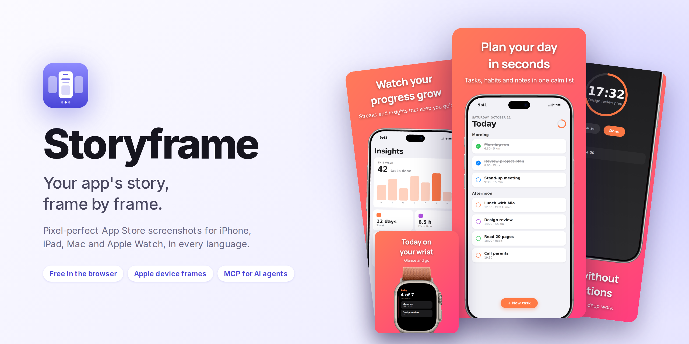
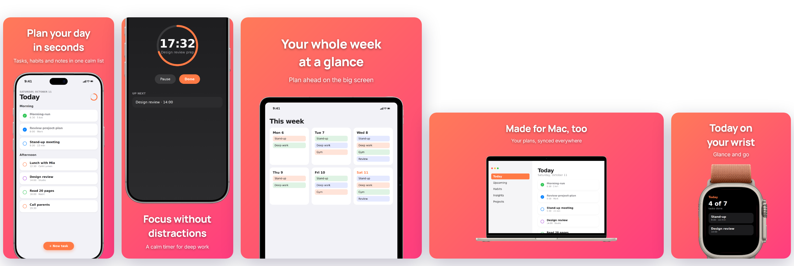

<p align="center">
  <a href="https://screenshots.linkandreas.de/">
    <picture>
      <source media="(prefers-color-scheme: dark)" srcset="docs/readme/hero-dark.png">
      
    </picture>
  </a>
</p>

<p align="center">
  <a href="https://screenshots.linkandreas.de/"></a>
  <a href="#-for-ai-agents-mcp"></a>
  <a href="CHANGELOG.md"></a>
  <a href="LICENSE"></a>
</p>

<p align="center">
  <a href="https://screenshots.linkandreas.de/"><b>Open the app</b></a> ·
  <a href="#-features">Features</a> ·
  <a href="#-every-app-store-slot">Devices</a> ·
  <a href="#-for-ai-agents-mcp">AI agents</a> ·
  <a href="#-run-it-yourself">Run it yourself</a> ·
  <a href="CHANGELOG.md">What's new</a>
</p>

<br>

App Store screenshots tell your app's story, one frame at a time. **Storyframe** turns your raw app
screenshots into that story: pick a layout, a background and an official Apple device frame, write
your headlines, and export pixel-perfect screenshots for every device and language, ready for App
Store Connect. Free, in your browser, no sign-up. Your screenshots never leave your machine.

## ✨ How it works

| 1. Add screenshots | 2. Style each screen | 3. Export |
| --- | --- | --- |
| Drop in your app's screenshots for iPhone, iPhone Duo, iPad, Mac or Apple Watch. | Pick a layout, a background and a frame, and write a headline. Add languages to localize. | Download every device and language as one ZIP, sorted the way App Store Connect expects. |

## 🎯 Features

| Feature | What you get |
| --- | --- |
| 📐 **Layouts that work** | Classic, Big & Bold, Floating, Text Below and Tilted, shown as live previews of your screen, with devices kept clear of your text. |
| 📱 **Official Apple frames** | iPhone 18 & 17 Pro Max, iPhone Duo, iPad Pro M5 & M4, MacBook Pro & Air, Apple Watch Ultra 3 & Series 11, fitted pixel-perfectly. |
| 🎨 **Backgrounds** | 52 gradients made for App Store screenshots, 28 solid colors, or your own, with text that stays readable automatically. |
| 🔤 **Typography** | Eight typefaces, sizes S to XL, alignment and colors for headline and subtitle. |
| 🌍 **Every language** | A set of screens per language; non-Latin scripts like Japanese and Chinese render correctly. |
| ✋ **Precise control** | Drag the device on the canvas, nudge it with the arrow keys, snap to center, tilt and scale. |
| ⚡ **One-click export** | All devices and languages at App Store resolution in one ZIP. |
| 🤖 **AI agents** | An MCP server lets Claude, Cursor and other agents create complete, branded sets for you. |
| 🌓 **Native feel** | A clean, Mac-like editor in light and dark mode that works on phones too. |

## 📱 Every App Store slot

<p align="center">
  
</p>

| Slot | Export size | Frames | Folder in the ZIP |
| --- | --- | --- | --- |
| iPhone 6.9" | 1320 × 2868 | iPhone 18 Pro Max, iPhone 17 Pro Max | `iPhone_6.9` |
| iPhone Duo, open | 2007 × 2853 | iPhone Duo | `iPhone_Duo_Inner` |
| iPhone Duo, closed | 1398 × 2034 | iPhone Duo | `iPhone_Duo_Outer` |
| iPad 13" | 2064 × 2752 | iPad Pro 13" (M5, M4) | `iPad_13` |
| Mac | 2880 × 1800 | MacBook Pro 16", MacBook Air 15" | `Mac` |
| Apple Watch Ultra | 422 × 514 | Apple Watch Ultra 3 | `Watch_Ultra` |
| Apple Watch | 416 × 496 | Apple Watch Series 11 (46 mm) | `Watch_Series` |

Upload screenshots at the App Store size. Other accepted sizes (for example Mac 1440 × 900) and the
same aspect ratio are scaled automatically. Exports are organized as `<folder>/<language>/screen_<n>.png`.

## 🤖 For AI agents (MCP)

Storyframe includes a [Model Context Protocol](https://modelcontextprotocol.io) server that renders
the same screenshots as the editor (same frames, layouts and typefaces) without a browser, so an
agent can turn your app's raw screenshots into a complete, branded set.

> *"Use Storyframe to make App Store screenshots for my habit tracker from `./shots/*.png`, in
> English and German. Coral gradient, white Manrope headlines, Big & Bold layout."*

### Hosted: nothing to install

```bash
# Claude Code
claude mcp add --transport http storyframe https://screenshots.linkandreas.de/mcp
```

- **Claude (web and desktop):** *Settings → Connectors → Add custom connector* with
  `https://screenshots.linkandreas.de/mcp`.
- **Cursor:** add `{"mcpServers": {"storyframe": {"url": "https://screenshots.linkandreas.de/mcp"}}}`
  to `.cursor/mcp.json`.

The hosted server can't read files on your machine: pass screenshots as https URLs, or upload them
first and use the returned reference. Results come back as download links (each PNG plus a ZIP)
that expire after an hour.

```bash
curl -s --data-binary @screen.png https://screenshots.linkandreas.de/mcp/uploads
# → {"image":"upload:…","width":1320,"height":2868,"expiresAt":"…"}
```

### Local: reads and writes your files

```bash
npm run mcp:install && npm run mcp:build
claude mcp add storyframe -- node "$PWD/mcp/dist/server.js"
```

Locally, screenshots can be file paths, and the PNGs are written to `outputDir` (default
`./appstore-screenshots` in the directory the agent starts the server from).

### Tools

| Tool | What it does |
| --- | --- |
| `get_design_options` | Devices and screenshot sizes, frames, typefaces, backgrounds, layouts, defaults and copywriting tips. |
| `render_screenshots` | Renders a set from a shared `brand` (background, text colors, typefaces, frame, layout) plus one `screens` entry per screenshot with `title`, `subtitle`, `locale`, `device` and optional overrides. Returns the files, warnings and small previews the agent can check. |

The `app_store_screenshot_set` prompt guides an agent through writing the copy, choosing a brand,
rendering and reviewing. Japanese, Chinese, Korean and other non-Latin text uses Noto fonts fetched
on demand.

## 🛠 Run it yourself

Requires [Node.js](https://nodejs.org/) 22 or later.

```bash
git clone https://github.com/LinkAndreas/AppStore-Screenshot-Generator.git
cd AppStore-Screenshot-Generator
npm install
npm run dev
```

| Command | |
| --- | --- |
| `npm run dev` | Editor with hot reload |
| `npm run build` | Type-check and build the editor into `dist/` |
| `npm run lint` | Lint the project |
| `npm run mcp:install`, `mcp:build`, `mcp:test` | Install, build and test the MCP server |
| `npm run mcp:start`, `mcp:start:http` | Run the MCP server over stdio or HTTP |

**Built with** React 19, TypeScript and Vite. The editor exports with `html-to-image` and `JSZip`;
the MCP server renders with `satori` and `resvg`. Both share the device catalog, layouts, fonts and
presets in `src/shared`, so they produce the same images.

<details>
<summary><b>Adding a device frame</b></summary>

1. Copy the portrait PNG from Apple's bezel download into `src/assets/Bezels/<pack>/PNG/`.
2. Measure it: `node scripts/measure-bezels.mjs "src/assets/Bezels/<pack>/PNG/<file>.png"` prints
   the bezel size, the screen opening (it should equal the App Store screenshot size) and the corner
   radii that make the screenshot fit.
3. Add it to `BEZELS` in `src/shared/layout.ts` with those numbers.
4. `npm run mcp:test` renders every frame and fails if the background shows through anywhere around
   the screen or the screenshot shows outside the device.

</details>

<details>
<summary><b>Releases and deployment</b></summary>

Release notes live in [CHANGELOG.md](CHANGELOG.md), which also feeds the app's "What's New" sheet.

Every push to `main` runs `.github/workflows/deploy.yml`: GitHub tests the MCP server, builds the
Docker images and pushes them, tagged with the commit SHA:

- `ghcr.io/linkandreas/appstore-screenshot-generator`: the editor served by
  [Caddy](https://caddyserver.com) (`docker/Caddyfile`), which also proxies `/mcp` to the MCP container.
- `ghcr.io/linkandreas/appstore-screenshot-mcp`: the MCP server (`Dockerfile` target `mcp`).

The Hostinger VPS only receives `compose.yaml` in `~/appstore-screenshot-generator`, pulls those
images and restarts the containers. They publish no ports: they join the shared Docker network
`web`, where the `cloudflared` container reaches the editor at
`http://appstore-screenshot-generator:32775` and serves it with HTTPS at
<https://screenshots.linkandreas.de>.

Repository secrets: `HOSTINGER_HOST`, `HOSTINGER_USERNAME`, `HOSTINGER_SSH_KEY`.

To roll back, run on the VPS:
`cd ~/appstore-screenshot-generator && TAG=<older commit sha> docker compose up -d`.

To run the production image locally:
`docker build -t appstore-screenshot-generator . && docker run --rm -p 32775:32775 appstore-screenshot-generator`
→ <http://localhost:32775>.

</details>

## 🙏 Credits

Device frames come from Apple's official
[product bezels](https://developer.apple.com/design/resources/#product-bezels). All rights to
these assets belong to Apple; they are used in accordance with Apple's design guidelines.

<details>
<summary>Bezel downloads used</summary>

- [iPhone 18](https://devimages-cdn.apple.com/design/resources/download/Bezel-iPhone-18.dmg) · [iPhone 17](https://devimages-cdn.apple.com/design/resources/download/Bezel-iPhone-17.dmg) · [iPhone Duo](https://devimages-cdn.apple.com/design/resources/download/Bezel-iPhone-Duo.dmg)
- [iPad Pro (M5)](https://devimages-cdn.apple.com/design/resources/download/Bezel-iPad-Pro-(M5).dmg) · [iPad Pro M4](https://devimages-cdn.apple.com/design/resources/download/Bezel-iPad-Pro-M4.dmg)
- [MacBook Pro M5](https://devimages-cdn.apple.com/design/resources/download/Bezel-MacBook-Pro-M5.dmg) · [MacBook Air M5](https://devimages-cdn.apple.com/design/resources/download/Bezel-MacBook-Air-M5.dmg)
- [Apple Watch Ultra 3](https://devimages-cdn.apple.com/design/resources/download/Bezel-Apple-Watch-Ultra-3-2025.dmg) · [Apple Watch Series 11](https://devimages-cdn.apple.com/design/resources/download/Bezel-Apple-Watch-Series-11-2025.dmg)

</details>

App Store, iPhone, iPad, Mac and Apple Watch are trademarks of Apple Inc. Storyframe is not
affiliated with Apple.

## 📄 License

[MIT](LICENSE) © 2026 Andreas Link. Contributions are welcome: open an issue or a pull request.

<sub>Originally coded using Google Antigravity. Made with ❤️ for the Apple developer community.</sub>
